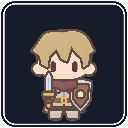
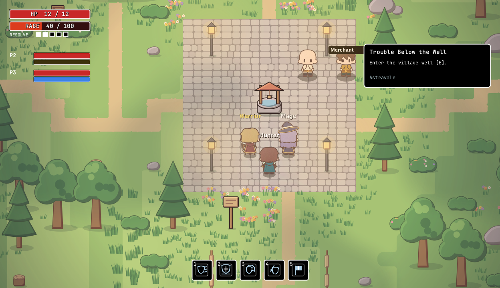
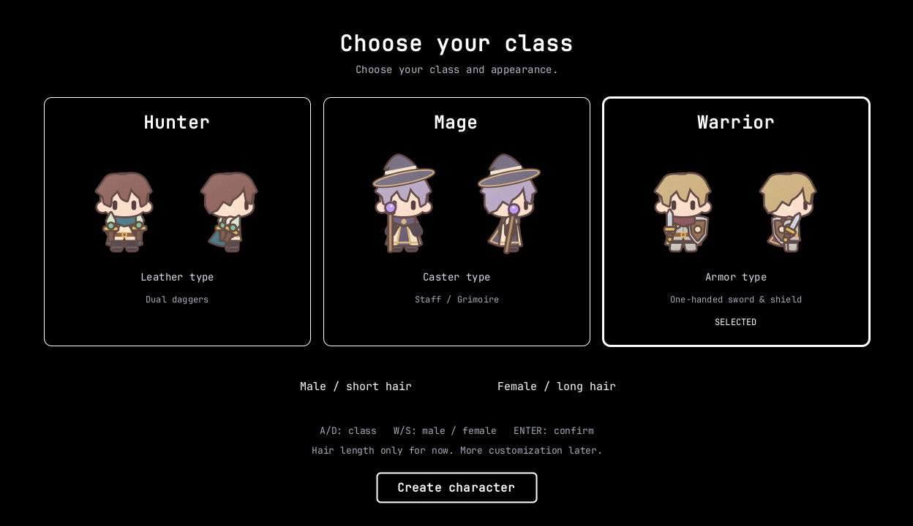
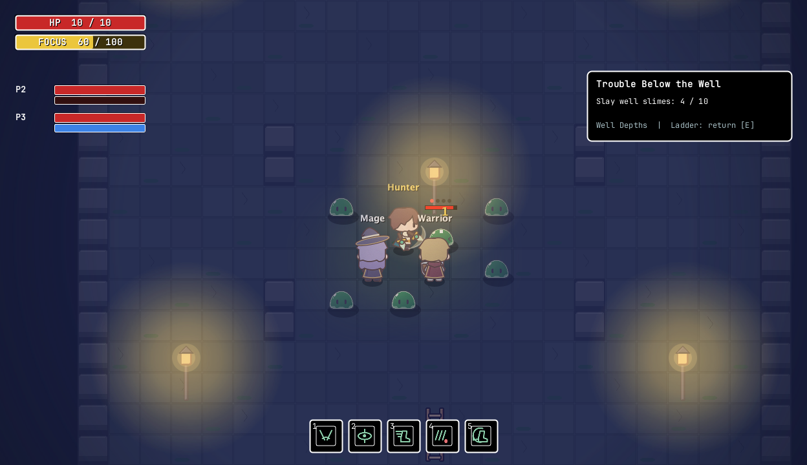
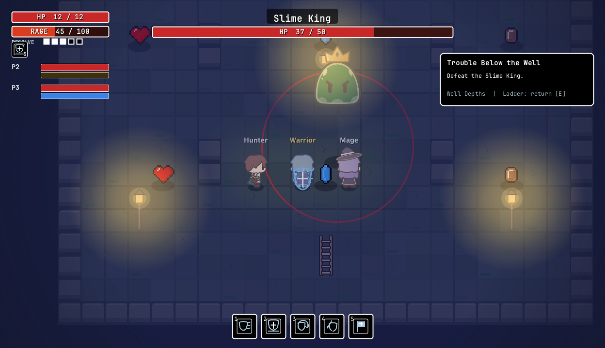
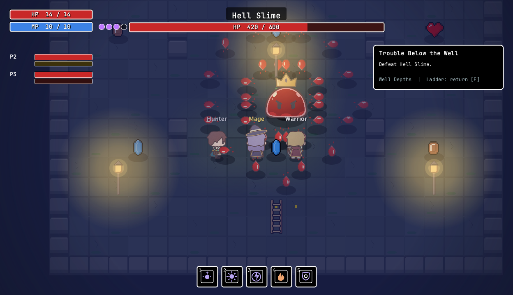
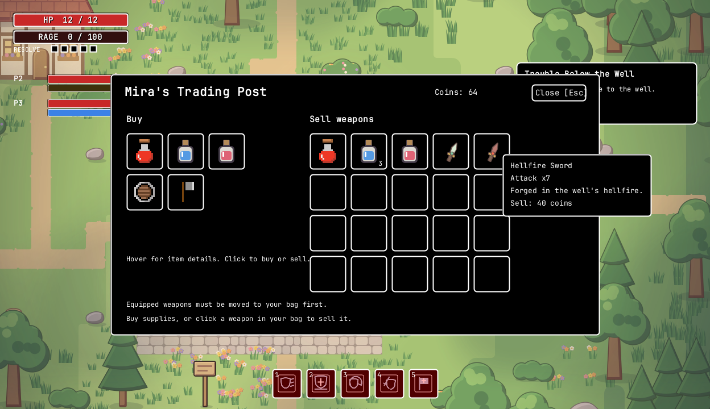

<div align="center">
  
  <h1>AstralCore</h1>
  <p><strong>A small town. A quiet well. Something waiting below.</strong></p>
  <p>A 2D fantasy action RPG for solo adventurers and parties of up to four.</p>
  <p><code>v0.1.0-alpha</code> &nbsp; · &nbsp; First playable alpha</p>
  <p>
    <a href="#download">Download</a> &nbsp; / &nbsp;
    <a href="#choose-your-class">Classes</a> &nbsp; / &nbsp;
    <a href="#screenshots">Screenshots</a> &nbsp; / &nbsp;
    <a href="#controls">Controls</a>
  </p>
</div>



<p align="center"><em>Welcome to Astravale. Your entrance exam is just below the plaza.</em></p>

## The first adventure

The old man has a simple job for you: **clear ten slimes from the village well**.

Choose a class, gather supplies, and descend into the lantern-lit Well Depths. The tenth slime is only the beginning. Defeat the Slime King, return for a class weapon, and use its Slime Essence to awaken a stronger opponent.

**Talk → descend → hunt → face the King → claim your reward → challenge Hell Slime.**

This alpha is built around that complete, repeatable loop. It is a small adventure with room to grow.

## Download

Every download includes **Java, game assets, maps, and libraries**. No separate Java installation is needed.

| Platform | Package | Launch |
| :--- | :--- | :--- |
| **macOS · Apple Silicon** | [Download Mac ZIP](https://github.com/Shiroik1/astralCore/releases/download/v0.1.0-alpha/AstralCore_v0.1.0-alpha-macos-arm64.zip) | Extract, then open `AstralCore.app`. |
| **Windows · x64** | [Download Windows ZIP](https://github.com/Shiroik1/astralCore/releases/download/v0.1.0-alpha/AstralCore_v0.1.0-alpha-windows-x64.zip) | Extract the entire folder, then open `AstralCore.exe`. |

[Release notes](docs/releases/v0.1.0-alpha.md) · [All releases](https://github.com/Shiroik1/astralCore/releases) · [SHA-256 checksums](https://github.com/Shiroik1/astralCore/releases/download/v0.1.0-alpha/SHA256SUMS.txt)

> **Alpha installation notes:** Keep the Windows `app` and `runtime` folders beside the executable. The Mac build is for Apple Silicon, not Intel Macs. These builds are not publisher-signed; the Mac app is not Apple-notarized, so your operating system may show a security warning.

**Testing status:** Mac startup verified. The Windows x64 package is built; native Windows launch and gameplay testing are still pending. Fifteen automated checks passed against the bundled Java 21 runtime.

## Choose your class



| Class | Equipment | What makes it different |
| :--- | :--- | :--- |
| **Hunter** | Fast, short-range dual daggers | Land hits to build **yellow Focus** and chain your attacks into a combo finisher. |
| **Mage** | Staff and fireballs | Land spells to build **runes**, then spend them on empowered magic. Missed casts do not charge runes. |
| **Warrior** | Longer-reach sword and a visible shield | Build **Resolve** through shield-mitigated damage, then turn defense into a stronger counterattack. |

Each class has **five skills**. Warrior's kit mixes Shield Bash, Bulwark, Retaliation, Shield Breaker, and Rally; Hunter emphasizes quick strikes and offensive buffs; Mage combines rune generation, detonation, haste, ignition, and shielding.

The published alpha offers short or long hair at creation. Equipment layers—including clothing, boots, gloves, hair, cloaks, and Mage headwear—can be equipped and removed.

**Current source builds:** character creation now includes **40 reference-inspired vector hairstyles** and **20 muted hair colors**, with clickable choices and front/side/back previews. Hairstyle and color save with the character and synchronize in co-op. Both hairstyle collections work with every class and preset; equipped headwear remains a separate layer.

## Screenshots

<table>
  <tr>
    <td width="50%">
      <a href="docs/images/well-depths.png"></a>
      <p align="center"><strong>The Well Depths</strong><br><sub>Slime hunting, class skills, and shared quest progress.</sub></p>
    </td>
    <td width="50%">
      <a href="docs/images/slime-king.png"></a>
      <p align="center"><strong>The Slime King</strong><br><sub>Read its warning, make space, and survive the slam.</sub></p>
    </td>
  </tr>
  <tr>
    <td width="50%">
      <a href="docs/images/hell-slime.png"></a>
      <p align="center"><strong>Hell Slime</strong><br><sub>600 HP, three projectile waves, and a charging attack.</sub></p>
    </td>
    <td width="50%">
      <a href="docs/images/merchant.png"></a>
      <p align="center"><strong>Mira's Trading Post</strong><br><sub>Buy supplies, sell spare weapons, and prepare for another run.</sub></p>
    </td>
  </tr>
</table>

*Captured from the v0.1.0-alpha game renderer. Click an image to view it at full size.*

## What is in this alpha?

- **A village hub:** the plaza, the old man's tutorial quest, a well entrance, and a merchant.
- **A forest healing pond:** follow the west path north into the trees, then press **E** at the pale stone to restore HP.
- **An underground dungeon:** ten quest slimes, live objective tracking, and a Slime King encounter with dialogue.
- **A repeatable boss challenge:** offer one Slime Essence at the well altar to summon Hell Slime. It drops another essence and stronger class weapons.
- **Six playable class choices:** Hunter Assassin, Hunter Ranger, Caster Mage, Caster Priest, Warrior Berserker, and Warrior Paladin, each with distinct equipment and skills.
- **Hunter Ranger:** tap left click for a quick shot, or hold until the bow flashes and release for a clean shot. Land arrows to build Focus for skills on **1–5**. Mira sells Ranger bows and leathers at levels 1, 5, 10, 17, and 25.
- **Hunter Assassin:** land two dagger pairs on one target to crit on the fourth cut. Mira sells five tiers of paired daggers and leathers.
- **Caster Mage:** land free Staff Bolts to build runes. Place Ember and Frost spells with the cursor, then spend runes on a close-range Detonation or a distant Cometfall. Mira stocks five tiers of staves and robes.
- **Caster Priest** uses Mend to link a Beacon to the ally under the cursor. Land Radiant Bolts to heal your Beacon, ward it with Aegis, and support your group with Hallowed Ground, Dawn Chorus, and Sanctuary. Mira stocks five tiers of Priest staves and vestments.
- **Warrior Berserker** earns Rage by landing wide, two-handed greatsword swings. Cleave groups, Rush into melee, Sunder armor, hit twice with Whirlwind, or send a shockwave forward with Worldbreaker. Mira stocks five greatsword and armor tiers.
- **Warrior Paladin** holds right click to Guard and builds Resolve by mitigating frontal hits. Spend it on Interpose, Oathstrike, or a Last Bastion wall that catches hostile projectiles. Mira stocks five sets of swords, shields, and armor.
- **A visible equipment system:** change or remove outfit pieces, weapons, shields, and headwear.
- **Solo and host/join co-op:** shared quest progress with independent plaza respawns. A surviving boss resets after a party wipe.
- **Adjustable display settings:** device-supported resolutions, fullscreen options, and an optional pixel filter.

## Controls

| Input | Action |
| :--- | :--- |
| **W A S D** | Move |
| **Left mouse** | Attack or cast |
| **E** | Interact with NPCs, the well, ladder, or altar |
| **1–5** | Use class skills |
| **C** | Open equipment and inventory |
| **Esc** | Close a shop/dialogue, or open options |
| **P** | Pause in single-player |
| **F5** | Save the active character (current source builds) |
| **Enter** | Open chat |

Hover shop items for descriptions and prices. Hover skill icons for their effects, costs, and cooldowns.

## Play with friends

One player hosts a session; the others join using the host's address. Every player should run the same release.

The host needs incoming **TCP port 5001** allowed through their firewall. Playing across the internet may also require router port forwarding. This alpha uses direct host/join connections; it does not include automatic matchmaking or a public server browser.

## Before you start

**Current source builds support five character saves.** Choose **PLAY**, **HOST GAME**, or **JOIN GAME**, then select a character slot to continue or create a new adventurer. Stats, inventory, equipment, location, quests, and dungeon progress save automatically every 30 seconds, with **F5** for a manual save and a save before returning to the title or closing the game. Guests keep their character gains; the host owns the session's world progress. See the [character save guide](docs/character-saves.md).

The published **v0.1.0-alpha downloads remain session-based** until a new release is packaged. Display and sound settings are saved separately.

The content is limited to the starter adventure, and balance and features are still changing. Hardware requirements and broader platform compatibility have not yet been established through wide playtesting.

Found a problem? [Open an issue](https://github.com/Shiroik1/astralCore/issues) with your game version, operating system, class, reproduction steps, and a screenshot if useful.

<details>
<summary><strong>Settings and startup logs</strong></summary>

- **Mac:** `~/Library/Application Support/AstralCore/`
- **Windows:** `%LOCALAPPDATA%\AstralCore\`
- **Startup log:** `logs/latest.log` inside that folder.

</details>

<details>
<summary><strong>Build from source</strong></summary>

The game uses Java and Swing/Java2D. Standalone downloads include Eclipse Temurin Java 21.

To build both packages on Apple Silicon macOS, install Python 3.12+ and a JDK 21+ with `javac`, `jar`, and `jpackage` available, then run:

```sh
python3 packaging/build_release.py --target all
```

The build verifies its pinned runtime/compiler downloads and writes the two ZIPs to `dist/`.

See the [packaging guide](packaging/README.md) for prerequisites, verification, user-data paths, and the GitHub Actions build workflow.

</details>

---

<p align="center"><strong>AstralCore</strong> &nbsp; · &nbsp; Made one adventure at a time.</p>
