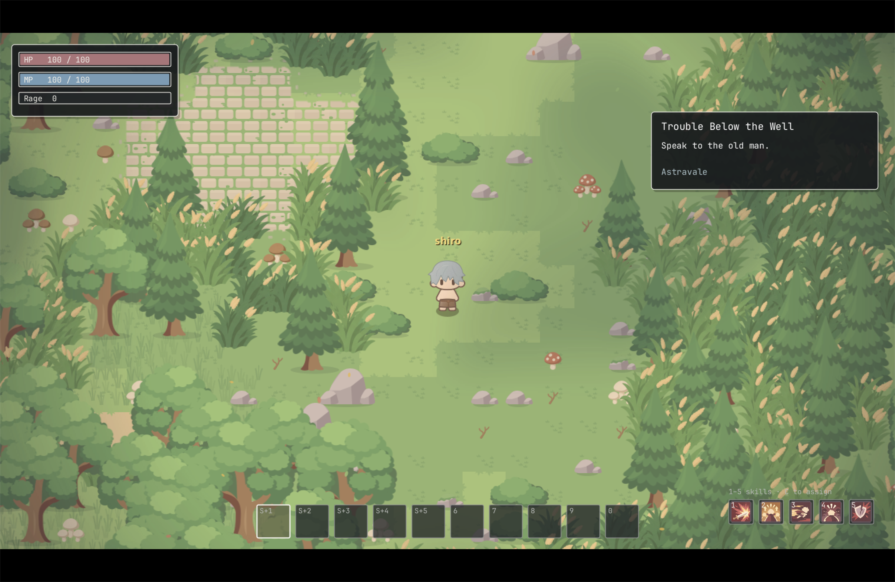
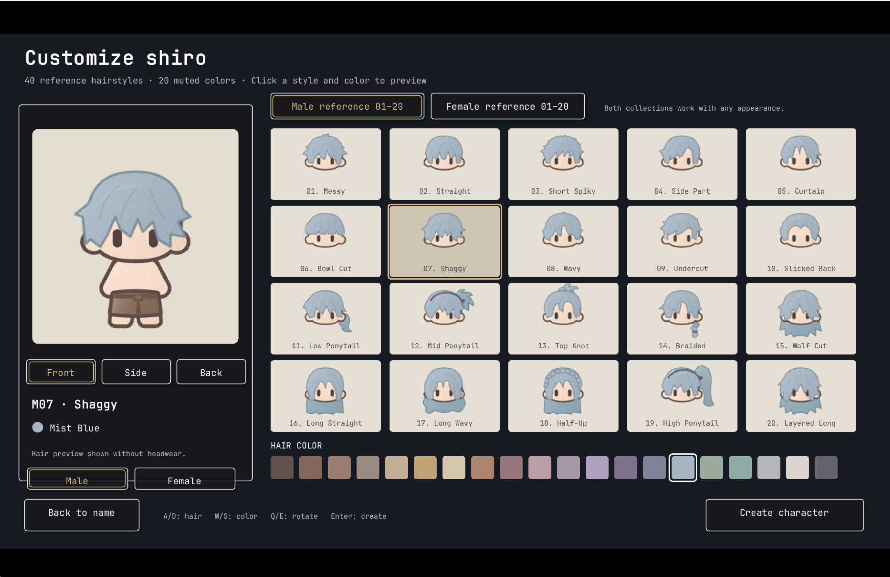
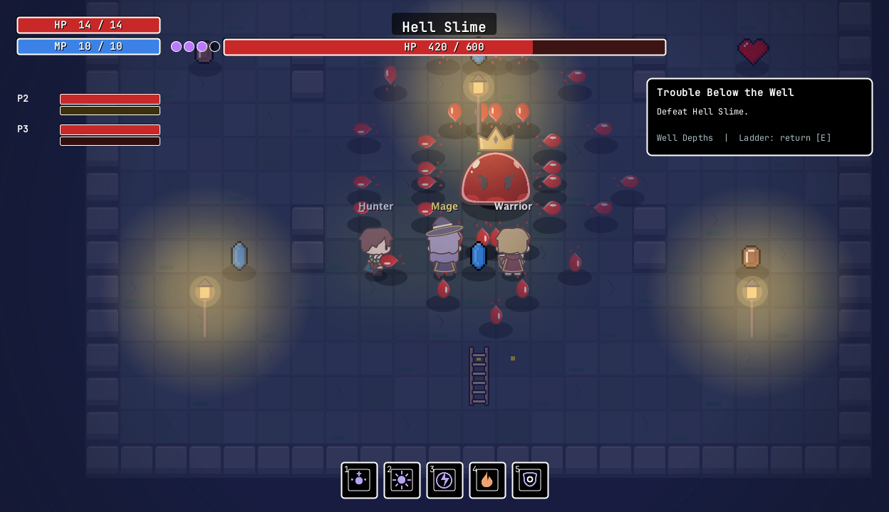
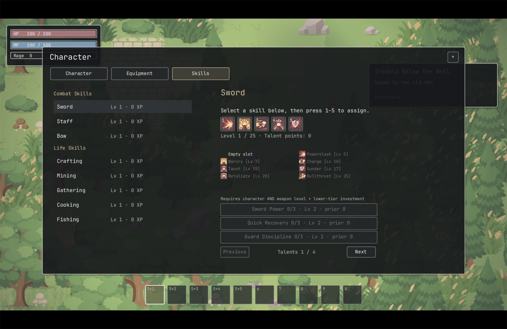

<div align="center">
  
  <h1>AstralCore</h1>
  <p><strong>Procedural fantasy action RPG with procedural world generation.</strong></p>
  <p><code>v0.2.0-alpha</code> &nbsp; · &nbsp; Procedural worlds, class playables, character creation</p>
  <p>
    <a href="#download">Download</a> &nbsp; / &nbsp;
    <a href="#world-generation">Procedural World</a> &nbsp; / &nbsp;
    <a href="#classes">Classes</a> &nbsp; / &nbsp;
    <a href="#character-customization">Character Creation</a> &nbsp; / &nbsp;
    <a href="#controls">Controls</a> &nbsp; / &nbsp;
    <a href="#screenshots">Screenshots</a>
  </p>
</div>



<p align="center"><em>Trees, forests, grasslands, and biomes generated with a single seed.</em></p>

## Procedural World Generation

Every new world is procedurally generated using version 11 generator with region-driven terrain:

- **Open terrain zones**: Flower plains, forest groves, pond shores, and rare connected golden meadows
- **Cliff formations**: Modular cliff sprites with rare inland formations (8% target, 10% maximum)
- **Physical boundaries**: Square/rectangular playable interior with irregular playable mask
- **Elevation system**: Separate heightmap with connected cliff rendering
- **Deterministic seeds**: Use `/regenworld <seed>` to recreate or demo a specific world

New worlds use version-eleven generation that restores square borders, removes wide forest reservation strips, and updates camera bounds. Existing saves retain their previous generation version.

**Generate a new world:** Open the game and create a character with default settings (or specify seed for deterministic recreation).

## Playable Classes

Three distinct combat styles, each with five abilities:

| Class | Weapon | Progression |
| :--- | :--- | :--- |
| **Warrior** | Longer-reach sword + shield | Build **Resolve** through shield-mitigated damage → counterattacks |
| **Mage** | Staff | Land spells to build **runes** → spend on empowered magic |
| **Hunter** | Dual daggers or bow | Land hits to build **Focus** → chain attacks into combos |

### Warrior Abilities
Shield Bash, Bulwark, Retaliation, Shield Breaker, Rally

### Mage Mechanics
- Place Ember and Frost spells with cursor positioning
- Spend runes on close-range Detonation or distant Cometfall
- Haste, ignition, and shielding abilities available
- Missed casts do not charge runes

### Hunter Mechanics
- **Hunter (Dual Daggers)**: Quick strikes build Focus for combo finisher; Assassin path critiques on fourth cut
- **Hunter Ranger**: Tap left click for quick shot, hold until bow flashes for clean shot; charged arrows build Focus
- Focus enables Shift + 1–5 abilities

## Character Customization

Choose your appearance at creation with extensive customization:

- **40 reference-inspired vector hairstyles** with front/side/back previews
- **20 muted hair colors** to complement any style
- **Equipment layers**: Clothing, boots, gloves, cloaks, headwear (separate from weapon choices)
- Warrior rhythm spenders included in progression

The character and equipped appearance synchronize in co-op sessions. New characters begin unarmed with an empty bag; gather resources and craft weapons at your first station.



## Screenshots

<table>
  <tr>
    <td width="50%">
      <a href="docs/images/procedural-world.png"></a>
      <p align="center"><strong>Procedural World</strong><br><sub>Trees, forests, grasslands, and biomes generated with a single seed.</sub></p>
    </td>
    <td width="50%">
      <a href="docs/images/character-creation.png"></a>
      <p align="center"><strong>Character Creation</strong><br><sub>40 reference-inspired hairstyles, 20 muted colors, appearance customization.</sub></p>
    </td>
  </tr>
  <tr>
    <td width="50%">
      <a href="docs/images/warrior-combat.png"></a>
      <p align="center"><strong>Warrior Combat</strong><br><sub>Sword and shield, Resolve building through mitigation.</sub></p>
    </td>
    <td width="50%">
      <a href="docs/images/mage-combat.png"></a>
      <p align="center"><strong>Mage Combat</strong><br><sub>Rune-based magic, Ember/Frost placement, Detonation/Cometfall.</sub></p>
    </td>
  </tr>
  <tr>
    <td width="50%">
      <a href="docs/images/hunter-combat.png"></a>
      <p align="center"><strong>Hunter Combat</strong><br><sub>Dual daggers or bow, Focus chains, combo finishers.</sub></p>
    </td>
    <td width="50%">
      <a href="docs/images/hell-slime.png"></a>
      <p align="center"><strong>Hell Slime</strong><br><sub>600 HP, three projectile waves, charging attack. Defeat after Slime King to unlock.</sub></p>
    </td>
  </tr>
  <tr>
    <td width="50%">
      <a href="docs/images/merchant.png"></a>
      <p align="center"><strong>Merchant</strong><br><sub>Buy weapons, armor, and craft materials.</sub></p>
    </td>
    <td width="50%">
      <a href="docs/images/progression.png"></a>
      <p align="center"><strong>Progression</strong><br><sub>Class abilities, attribute points, talent trees.</sub></p>
    </td>
  </tr>
</table>

*Captured from the v0.2.0-alpha game renderer. Click an image to view at full size.*

## Controls

| Input | Action |
| :--- | :--- |
| **W A S D** | Move |
| **Left mouse** | Attack or cast |
| **F** | Interact (adjacent tile you face) |
| **G** | Recover adjacent station |
| **E** | Inventory & Crafting (K = recipes) |
| **1–9 / 0** | Select item hotbar slots 1–10 |
| **Mouse wheel** | Cycle hotbar; scroll recipes inside Crafting |
| **Shift + 1–5** | Class abilities (rune/detonation for Mage; combo chains for Hunter) |
| **C** | Character, Equipment and Skills tabs |
| **Esc** | Close shop/dialogue, or open options |
| **F5** | Manual save |
| **Enter** | Open chat |

## Download

Every download includes **Java, game assets, maps, and libraries**. No separate Java installation is needed.

| Platform | Package | Launch |
| :--- | :--- | :--- |
| **macOS · Apple Silicon** | [Download Mac ZIP](https://github.com/Shiroik1/astralCore/releases/download/v0.2.0-alpha/AstralCore_v0.2.0-alpha-macos-arm64.zip) | Extract, then open `AstralCore.app`. |
| **Windows · x64** | [Download Windows ZIP](https://github.com/Shiroik1/astralCore/releases/download/v0.2.0-alpha/AstralCore_v0.2.0-alpha-windows-x64.zip) | Extract the entire folder, then open `AstralCore.exe`. |

[Release notes](docs/releases/v0.2.0-alpha.md) · [All releases](https://github.com/Shiroik1/astralCore/releases) · [SHA-256 checksums](https://github.com/Shiroik1/astralCore/releases/download/v0.2.0-alpha/SHA256SUMS.txt)

> **Alpha installation notes:** Keep the Windows `app` and `runtime` folders beside the executable. The Mac build is for Apple Silicon, not Intel Macs. These builds are not publisher-signed; the Mac app is not Apple-notarized, so your operating system may show a security warning.

## Procedural World Showcase

New worlds use **version 11 generation** with:
- Open terrain variety (flower plains, forests, ponds, golden meadows)
- Modular cliff formations with rare inland areas
- Square/rectangular playable border with irregular interior mask
- Physical plateau boundaries and connected cliff layers

Existing saves retain their previous generation version. Use a new character to experience the procedural world generation.

## Before You Start

**Five character save slots:** Choose **PLAY**, **HOST GAME**, or **JOIN GAME**, then select a character slot. New characters start unarmed with an empty bag; gather resources and craft weapons at stations.

Stats, inventory, equipment, location, and quests save automatically every 30 seconds. F5 saves manually (also in co-op sessions). Guests keep their gains; the host owns world progress.

## Co-op Multiplayer

One player hosts; others join via address. Host needs incoming **TCP port 5001** allowed through firewall. Playing across the internet may also require router port forwarding. This alpha uses direct connections; no matchmaking or server browser included.

## Build from Source

The game uses Java and Swing/Java2D. Standalone downloads include Eclipse Temurin Java 21.

To build both packages on Apple Silicon macOS:
```sh
python3 packaging/build_release.py --target all
```

See the [packaging guide](packaging/README.md) for prerequisites, verification, user-data paths, and GitHub Actions workflow.

---

<p align="center"><strong>AstralCore</strong> &nbsp; · &nbsp; Procedural worlds, endless adventures.</p>
