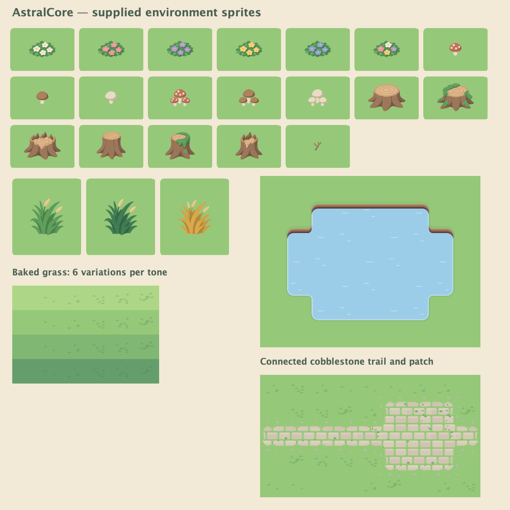

# Procedural grassland — Phase 1

The default launch builds a finite 100 × 100 temperate grassland with seed `123456789L`, using the existing 48-pixel game tile size. It uses the JPanel/Java2D renderer and threaded game loop. Generation runs at startup, before gameplay, and only repeats when explicitly requested through the development command.

## Configuration

In IntelliJ, open **Run → Edit Configurations → Modify options → Add VM options**, then enter, for example:

```text
-Dastral.world.seed=987654321 -Dastral.world.width=100 -Dastral.world.height=100 -Dastral.world.vegetation=0.65
```

For a packaged JAR, put these options before `-jar`. Seeds are signed decimal Java longs, without an `L` suffix in VM options. Defaults also live in `src/world/generation/WorldConfig.java`; programmatic configuration uses its record constructor.

| JVM property | Default | Meaning |
| --- | --- | --- |
| `astral.world.mode` | `procedural` | Use `authored` to load the existing town, NPCs, inn and well entrance from the original map files. |
| `astral.world.seed` | `123456789` | Signed 64-bit world seed. |
| `astral.world.width` | `100` | Width in tiles. |
| `astral.world.height` | `100` | Height in tiles. |
| `astral.world.vegetation` | `0.65` | 0–1 baked ground-grass detail coverage and bush placement. Body-height fields use the separate fields setting. |
| `astral.world.trees` | `0.18` | 0–1 tree candidate probability within dense noise regions; spacing rules still apply. |
| `astral.world.flowers` | `0.65` | 0–1 flower coverage within small noise patches; flowering bushes also follow those patches. |
| `astral.world.rocks` | `0.008` | 0–1 rock candidate probability within rock noise regions. |
| `astral.world.vegetationScale` | `0.09` | Vegetation noise frequency. Lower values make larger clusters and clearings. |
| `astral.world.terrainScale` | `0.055` | Ground-tone noise frequency. Lower values make broader tone regions. |
| `astral.world.dirtThreshold` | `0.77` | 0–1 dirt noise cutoff. Lower values create more dirt; 1 disables dirt. |
| `astral.world.toneContrast` | `1.0` | Positive grass-tone contrast. Smaller values favor the middle tones. |
| `astral.world.fields` | `0.75` | 0–1 coverage of body-height grass fields; 0 disables them. Green and dark green mix; golden fields use a separate noise region. |
| `astral.world.ponds` | `1.0` | 0–1 small-pond density; 0 disables ponds. The default budget is about four per 100 × 100 world, subject to space. |
| `astral.world.details` | `0.65` | 0–1 mushroom, stump and twig density in suitable vegetation/dampness regions. |
| `astral.world.mossPaths` | `0.7` | 0–1 continuity of the weathered mossy trail; 0 disables it. |
| `astral.world.cobblePatches` | `0.7` | 0–1 density of irregular moss-cobblestone clearings/patches, separate from the trail. 0 disables patches. |
| `astral.world.slimes` | `20` | Target overworld slime population, capped by available monster slots. Set 0 to stop new spawns. |
| `astral.world.slimeRespawnSeconds` | `15` | Active-play seconds between attempts to replace one missing slime. |
| `astral.dev` | `false` | Enables `/regenworld <seed>`. |

Dimensions must each be at least 16, with at most 1,000,000 tiles total. This is an allocation guard, not a performance promise: terrain images and meadow state are still allocated for the whole finite world. Start with 100 × 100. Width/height and other settings take effect on restart.

Enable `-Dastral.dev=true`, open the existing chat command input, and enter:

```text
/regenworld 42
```

This runs on the game thread, rebuilds terrain caches and scenery once, resets meadow animation, and moves players to the clear spawn. It is restricted to the offline procedural overworld. A short pause during rebuilding is expected. It does not change inventory, character stats, quest progress or the character save format. Use a development character: existing dropped items or effects keep their positions when the landscape changes.

## How generation works

`NoiseGenerator` hashes the full long seed, global tile/lattice coordinates and independent channels. Smooth quintic interpolation blends value noise, with three octaves for regional detail. There is no shared mutable random sequence. Terrain tones, dirt, vegetation, flower patches, rocks, tall-grass fields, dampness, ponds and coordinate selection use distinct channels.

`TerrainGenerator` assigns grass and existing dirt-path terrain, plus four existing ground tones. The tile renderer already blends adjacent tones and path borders. These tones are color variation, not elevation.

`ObjectGenerator` places tree candidates only in high-density vegetation, bushes in medium/high density, flowers in smaller correlated patches, and rocks in sparse rock regions. Coordinate hashes select candidates and variants within those fields. It then checks the actual sprite dimensions and collision footprints from the existing asset catalog. A conservative occupancy grid reserves half a tile around solid footprints to prevent overlap and leave walking gaps. Crowns may overlap other crowns for natural clusters; solid footprints cannot overlap. Meadow placement avoids occupied cells.

A gently wandering, five-tile-wide grassy corridor connects the left and right boundaries. Consecutive column bands overlap, including with unusual configured dimensions. A seven-by-seven clear spawn area joins that corridor at one quarter of the world width. Scenery image bounds and collision clearance cannot enter these reserved cells. Meadow has extra horizontal/vertical buffers so body-height bend frames also leave the route, water and map boundary clear. Sprite bounds stay within the world. Grass and paths remain walkable. Pond water is solid through the existing tile collision checker, which also stops players at world boundaries. Ponds and their shore margins cannot enter the reserved route or spawn clearing.

Terrain is baked into the existing 16 × 16 rendering caches. Those caches are rendering batches, not world streaming. Existing `WorldObject` instances retain their collision, transparency, wind sway and foot-point depth sorting. `GrassLayer` retains its cached bend atlases, movement response and drawing around player feet. Body-height grass uses cached `FieldTuft` draw layers in the same foot-depth sort as players and scenery, covering bodies behind it while leaving nearer players in front. It is nonblocking. Each field cell contains two or three clumps, with mixed green/dark-green regions and exclusively golden tall grass in golden regions. No asset decode or world generation is added to frame rendering.

## Existing assets used

| Content | Existing resource/catalog |
| --- | --- |
| Ground and tone transitions | `res/ground/grass.png`, `grass-edge-0.png` through `grass-edge-3.png` |
| Dirt patches | `res/ground/path-0.png` through `path-2.png` via `Terrain.PATH` |
| Oak/pine clusters | `res/scenery/foliage/oak_1.png`, `oak_2.png`, `pine_1.png`, `pine_2.png` |
| Bushes | `res/scenery/foliage/bush.png`, `flower_bush.png` |
| Rocks | `res/scenery/props/rock_small.png`, `rock_large.png`, `rock_small_moss.png`, `rock_large_moss.png` |
| Ground grass detail | `res/ground/grass-variants.png`, `grass-detail.png` (six variations × four tones) |
| Body-height fields | `res/scenery/meadow/field_green.png`, `field_dark.png`, `field_golden.png` |
| Authored flower layer | `res/scenery/meadow/flowers.png` |

Resource paths stay in the existing loaders/catalogs. `WorldPalette` maps existing `WorldObjectType` entries and reads their loaded image/solid dimensions; generation never constructs filenames or placeholder graphics.

## Files and integration

| Files | Responsibility |
| --- | --- |
| `src/world/generation/WorldConfig.java` | Validated dimensions, biome, seed and density/noise settings; generator version. |
| `NoiseGenerator.java` | Seeded smooth value noise and coordinate hashes. |
| `GeneratedWorld.java` | Terrain, tone, meadow, reservation and scenery placement data. |
| `WorldPalette.java` | Existing asset footprint adapter. |
| `TerrainGenerator.java`, `ObjectGenerator.java`, `WorldGenerator.java` | Separate terrain/object generation and orchestration. |
| `src/main/Gamepanel.java` | Startup configuration/data and development regeneration; loaded-position safety. |
| `src/tile/TileManager.java` | Generated terrain installation and cache rebuild; dimension-safe cache keys. |
| `src/world/SceneryLoader.java`, `GrassLayer.java` | Consume generated data instead of authored files in procedural mode. |
| `src/world/InnInterior.java` | Keep the authored inn's reserved coordinates from intercepting larger procedural maps. |
| `src/entity/Player.java` | Generated spawn for creation, default placement and respawn. |
| `src/main/AssetSetter.java` | Omit the authored town NPCs in procedural mode. |
| `src/save/SaveStore.java` | Move a loaded outdoor character to spawn if its old position is now blocked/outside the map. |
| `src/main/CommandProcessor.java` | Development regeneration command and clear feedback for disabled authored-map export. |

The authored `maps/` files are retained and never overwritten by procedural startup or regeneration. `/saveobjects` and `/savegrass` refuse procedural exports. Manual placement/painting remains temporary in this mode.

## Boundaries and compatibility

World identity is seed **plus all generation settings, generator version and the existing asset catalog**. `WorldConfig.GENERATOR_VERSION` is currently 4; increment it when changing generation rules. Animated wind and other transient effects are not part of deterministic world layout. Authored ground/path micro-variants already use fixed coordinate hashes; generated terrain regions, tones, meadow variants and scenery follow the configurable seed.

The current revision adds ordinary Green Slimes to procedural overworlds. It adds no buildings, NPCs, new dungeons, quests or multiplayer generation. Use `-Dastral.world.mode=authored` for the existing town/quest content and existing multiplayer play. No network protocol or seed synchronization is added. Existing combat, inventory, saves and authored content remain available; procedural mode supplies the landscape and a small slime population using existing combat and drops.

Seeds/settings and generated objects are not persisted in character saves yet. Relaunch with the same settings to reconstruct the same landscape. Prefer a separate development character; old saves retain their quest and dungeon state. An outdoor position blocked by a different seed is relocated to the generated spawn. Future world persistence should store configuration/version alongside characters/worlds before supporting durable edits.

Noise uses global coordinates in preparation for chunks, but placement resolves occupancy in a stable row-major finite-world pass. Future independent chunk generation will need deterministic neighboring candidate resolution/halos; it is not implemented here. Extra biomes, rivers/larger lakes, elevation, structures, streaming and persistence remain future work.

## Verification status

Implementation received read-only code and asset-reference review. The offline artwork exporters were compiled and run to produce the runtime PNGs, and their artwork was visually reviewed. The full game was not compiled or launched. No tests, gameplay runs, smoke checks, benchmarks or package verification were run, per the project owner's approval requirement. Determinism, appearance and movement still need approved runtime verification.


## Meadow expansion artwork



The expansion adapts the supplied concepts to AstralCore's muted, outline-free style. Runtime content includes six stemless flower patch colors (white, pink, purple, yellow, blue, mixed), red/brown/ivory mushrooms in single and triple forms, clean/mossy/aged oak and pine stumps, exactly one dry twig sprite, and green/dark-green/golden body-height grass. Flower patches, mushrooms and twigs are walkable; stumps reuse scenery collision boxes. Mushrooms favor damp/dense patches and stumps/twigs favor wooded vegetation regions. Golden field placement does not mix green body-height grass into its interior.

Six masked moss-cobble overlays vary stone arrangement and moss coverage. A seed-driven winding trail uses them; existing authored cobble artwork stays intact. Small ponds use a wetness field and deterministic candidate priorities, separation, edge margins and protected-route rejection. The water sheets now draw layered earth strata on back-facing shores using the central `Palette.WATER` color. Connected mask borders extend beyond the tile before bank shading so internal water joins do not acquire false walls.

The production nature art comes directly from the owner-supplied `assets/reference/environment/user-supplied-atlas.png`. Earlier generated atlases and vector studies are retained only as references. Runtime exports live in `res/scenery/nature/` and `res/scenery/meadow/field_*.png`; terrain exports are `res/ground/moss-path-0.png` through `moss-path-5.png` and the updated `water-*.png`. `NatureProp` holds nature sprite sizes and anchors, `GenerateNatureTextures` extracts the supplied sprites without recoloring and bakes 25 bend frames, and `PondGenerator` adds pond terrain before objects are placed. Generator version 4 adds cobblestone patches and intentionally changes layouts for existing seeds.

To regenerate production artwork, compile the art-only classes into a temporary output folder, then run `art.GenerateNatureTextures` and `art.GenerateGroundTextures --environment`. The nature exporter defaults to the supplied source sheet and accepts an alternative source sheet path as its first argument. It crops/scales sprites without recoloring or redrawing them. The ground export option updates grass variants/detail, moss paths and water; it does not rewrite other terrain. `GenerateGrassTextures` now exports only the retained authored flower sheet; the two old short/medium grass atlases are retired. These are authoring operations, separate from game startup; exported images are loaded once and shared.

New controls can be supplied alongside the original options:

```text
-Dastral.world.fields=0.75 -Dastral.world.ponds=1.0 -Dastral.world.details=0.65 -Dastral.world.mossPaths=0.7
```


## Minimalist vector textures, baked grass and slime population

Nature exports use the exact supplied sprite artwork and its original colors, shadows and highlights. There is no color remapping or material classification, so mushroom caps and stems keep their source appearance. Antialiased silhouette edges remain transparent.

The old `short.png` and `tall.png` meadow sheets are no longer loaded or generated. Copies are preserved under `assets/reference/environment/legacy-meadow/`. Their old authored cell IDs are ignored. Ordinary grass is built into six ground variations per tone, including a clean variant. Smooth tone-boundary tiles use a matching transparent detail sheet so the existing tone transitions remain intact. `TileManager` bakes these into the ground cache once. Only the body-height fields keep animated grass layers. The field editor now uses `/paint green`, `/paint dark`, `/paint golden`; keys 1/2/3 select those fields. Old `short`/`tall` brushes are removed.

The moss path has warm stone base fills with a narrow top-plane highlight, mixed from the existing stone and path palettes. Cracks and exterior cut-ins are transparent, revealing the actual grass tone underneath. Its 256-mask sheets provide ends, sides, corners, concave corners and junctions, rather than painting a mismatched rectangular background. Existing authored town cobble remains intact.

`world.SlimeSpawner` uses the existing `MON_GreenSlime` and monster slots. Initial positions use an independent seed-derived random stream. While playing, it attempts to replace one missing slime per configured interval up to the population target. It checks full collision footprints and clearance against terrain, scenery, interactive tiles, NPCs and existing monsters. It avoids protected spawn/route cells, players by at least seven tiles, and every player's camera view plus a tile margin. Small/crowded maps may support fewer slimes; attempts are bounded. Spawn checks pause with gameplay and do not run in the well or on network clients. The authored town remains peaceful. Monsters retain normal combat, AI, drops and save/snapshot behavior; terrain generation remains independent of runtime spawning. Development world regeneration resets this population.

```text
-Dastral.world.slimes=20 -Dastral.world.slimeRespawnSeconds=15
```

Artwork exporters were compiled and run, and the exported art was reviewed. No full-game compilation, gameplay checks, tests, benchmarks or package verification were run for this revision.


## Time and cloud motion

The default slime target is now 20 (subject to free monster slots and safe spawn space). The one-replacement attempt interval remains 15 seconds. If a launch configuration explicitly sets `astral.world.slimes`, update that override to use the new target.

A full day now takes 16 real minutes, compared with 20 previously: time advances 25% faster. Adjust `DayCycle.DAY_MINUTES` for another duration. Cloud shadows now drift at approximately 18 world pixels/second before the gentle wind modifier (up from 8.4 in the previous revision). `Lighting.CLOUD_SPEED` controls this. Wind-driven horizontal speed eases toward its target. A reusable repeating texture paint, sampled with fractional translation and bilinear interpolation, replaces integer-rounded tile positioning; this avoids the former stepping without rebuilding cloud images per frame. Runtime smoothness still requires approved gameplay verification.


## Smooth vector exports and cobblestone patches (version 4)

Flowers, mushrooms, stumps, twigs and tall-grass clumps now come from the owner-supplied sprite sheet. Cropped source sprites use antialiased, alpha-aware supersampling during export, with no recoloring or redraw. Nature prop PNGs export at twice their logical dimensions, matching the older town-prop convention. `NatureProp.EXPORT_SCALE` and the existing scenery loader scale them back once at load time; foot anchors, logical dimensions and collisions stay unchanged. Field frames apply the existing offline bend transform to the supplied grass clumps. Earlier generated artwork and the alternate vector study are retained for later reuse; the supplied atlas is the active source.

`CobblePatchGenerator` adds a few irregular elliptical remnants of mossy paving, with smooth noise perturbing their outlines. Seeded candidate priorities, spacing and boundary checks keep them sparse. Patches avoid pond water and the reserved spawn/crossing areas. They reuse `Terrain.MOSS_PATH` and its existing neighbor masks, so patches and trails can connect without a second incompatible paving set. Vegetation/scenery placement follows the updated terrain. The default density is 0.7, roughly four patches in a 100 × 100 map when suitable space exists:

```text
-Dastral.world.cobblePatches=0.7
```

Generator version 4 changes layouts for existing seeds. Runtime texture paths stay stable. Cloud drift is now 0.30 world pixels/tick (about 18/second), retaining eased velocity and fractional texture sampling. Artwork exports and source references were reviewed; no full-game compilation or gameplay verification was run.

Moss-cobble stones now use rounded vector silhouettes matching the old cobble artwork. Exposed edges have small rounded grass cut-ins instead of repeated sharp blade notches. Both the stone shapes and their neighbor-mask borders are supersampled during export.


## Owner-supplied sprite sheet

The active source is now `assets/reference/environment/user-supplied-atlas.png`, copied from the uploaded sheet. Row 1 supplies six stemless flower patches; row 2 supplies red/brown/ivory single and triple mushrooms; row 3 supplies the six oak/pine stumps; row 4 supplies the twig and green/dark-green/golden grass clumps. Import only crops, scales and bakes existing wind frames. All source colors and alpha are preserved through normal antialiased image compositing. The alternative hand-authored vector source is archived under `assets/reference/environment/vector-study/` and is not used.

Run `art.GenerateNatureTextures` to re-export this same sheet. Runtime resource paths and gameplay behavior remain unchanged. Artwork was exported and reviewed; the full game was not compiled or launched.


## Cobblestone transitions

Regular `COBBLE` and procedural `MOSS_PATH` now use neighbor-aware borders over the same blended grass base. Ends, outside corners, inside corners and junctions use matching masks; diagonal neighbors select corner details. A small exposed-edge alpha fade and rounded grass inlets soften the join without a mismatched fixed-color rim. Neighboring grass receives sparse connector stones that taper the paving outward. Patches reuse these same connectors. No terrain collision, placement or world seed rules change.

See [cobblestone transition artwork](images/cobblestone-transitions.png) for the exported regular/mossy edges over all four grass tones. Artwork exports were visually reviewed; no full-game compilation or gameplay checks were run.
