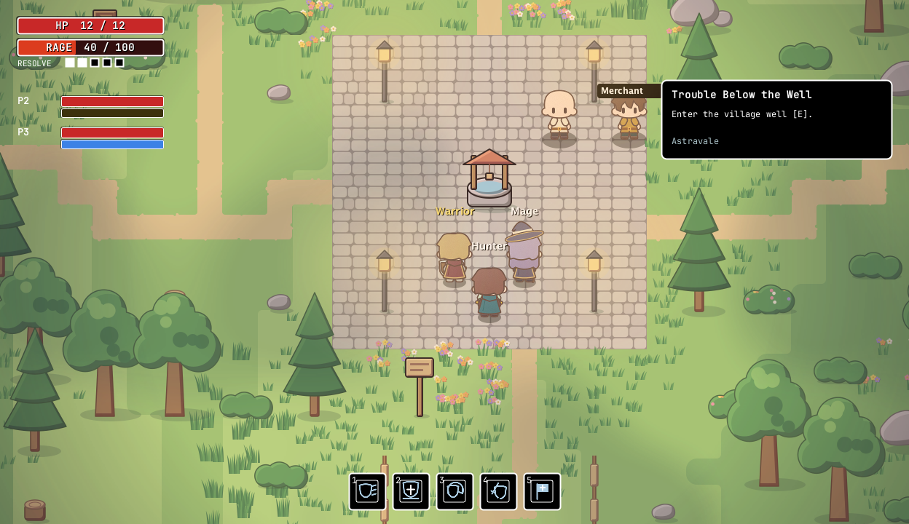
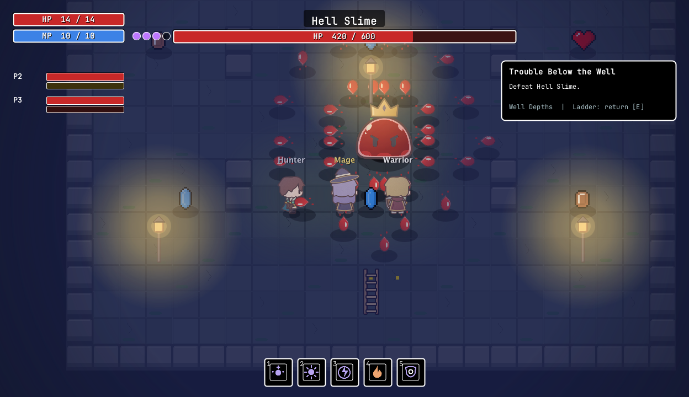

# AstralCore v0.1.0-alpha

**The first playable alpha is here. Welcome to Astravale.**

An old man, a village well, and a supposedly simple slime problem. This release brings AstralCore's first adventure together: pick a class, descend into the Well Depths, defeat the Slime King, and return for a weapon worthy of your class. Then offer Slime Essence at the altar and see what answers.

## Download and play

Java and all game files are included. Extract the complete ZIP before launching.

| Platform | Download | Open |
| --- | --- | --- |
| Apple Silicon Mac | [AstralCore_v0.1.0-alpha-macos-arm64.zip](https://github.com/Shiroik1/astralCore/releases/download/v0.1.0-alpha/AstralCore_v0.1.0-alpha-macos-arm64.zip) | `AstralCore.app` |
| Windows x64 | [AstralCore_v0.1.0-alpha-windows-x64.zip](https://github.com/Shiroik1/astralCore/releases/download/v0.1.0-alpha/AstralCore_v0.1.0-alpha-windows-x64.zip) | `AstralCore.exe` |

[SHA-256 checksums](https://github.com/Shiroik1/astralCore/releases/download/v0.1.0-alpha/SHA256SUMS.txt)

Keep the Windows `app` and `runtime` folders beside the executable. Mac support in this release is for Apple Silicon only.

## Inside the alpha

- **The first quest:** talk to the old man, defeat ten slimes beneath the well, and face the Slime King. Report back for coins, experience, and a class weapon.
- **Three classes:** Hunter uses fast dual daggers and yellow Focus; Mage builds runes by landing spells; Warrior combines a sword and shield with defense-powered Resolve counters.
- **Five skills per class:** updated icons and hover descriptions, with distinct effects for Warrior skills.
- **Hell Slime:** a repeatable, 600-HP red boss with three consecutive radial projectile waves, a slam, and a telegraphed charge. Offer one Slime Essence to summon it; victory drops another essence and stronger Hell weapons.
- **Mira's shop:** buy potions and equipment, or sell spare weapons through an icon-based menu with floating item details.
- **Equipment and appearance:** visible outfit layers, removable gear, Mage headwear, and short/long hair choices.
- **Solo or co-op:** shared quest progress, independent plaza respawns, and boss resets after a party wipe.
- **Display options:** fullscreen, device-supported resolutions, and an optional pixel filter.

## Your first run

1. Create a character and speak to the old man at the plaza.
2. Press **E** at the well to descend.
3. Slay ten slimes and defeat the King.
4. Return using the ladder and claim your reward.
5. Bring Slime Essence to the altar for the Hell Slime challenge.

**Controls:** WASD to move, left mouse to attack/cast, E to interact, 1–5 for skills, C for inventory, and Esc for options or closing a menu.

For co-op, use the same release on every machine. The host must allow incoming TCP port 5001; internet connections may require router port forwarding.

## Alpha notes

- **Progress is not persistent yet.** Characters, quests, levels, and inventory are session-based. Display and sound settings are saved.
- This is the starter adventure, not the full game. Content, features, and balance will continue to change.
- **Mac startup is verified.** The Windows x64 package has been built, but native Windows launch and gameplay testing are still pending.
- Fifteen automated checks passed against the bundled Java 21 runtime.
- The builds are not publisher-signed, and the Mac app is not Apple-notarized. Your operating system may display a security warning.

Please [report bugs](https://github.com/Shiroik1/astralCore/issues) with your platform, class, game version, and steps to reproduce the problem. Feedback on combat feel, difficulty, and the first quest is especially welcome.

Thanks for playing this first version of AstralCore.
